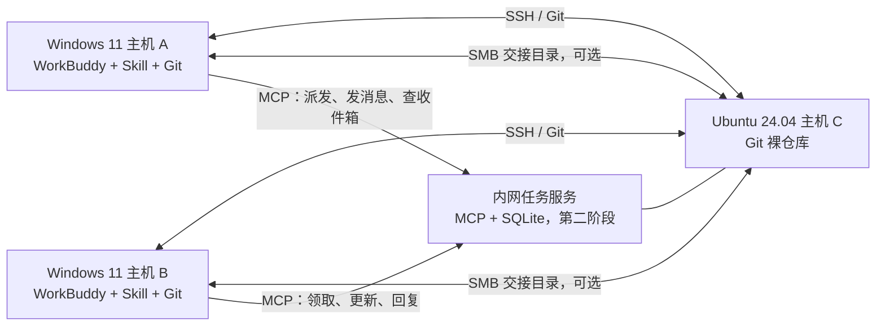
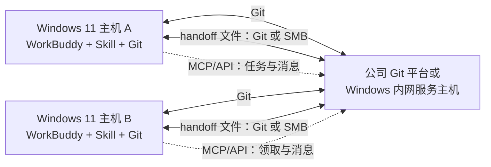

# WorkBuddy 局域网交接与协作方案（Ubuntu 中枢与纯 Windows）

**适用环境**：主场景为 A、B 两台 Windows 11 运行 WorkBuddy，C 为 Ubuntu 24.04 且与 A、B 在同一局域网；文档也包含没有 C、只有 A/B 两台 Windows 时的替代方案。

**目标**：让 A、B 通过可访问的 Git 服务同步代码，并通过交接包把任务上下文交给另一台机器；有 Ubuntu C 时优先在 C 上部署服务，只有 A/B 时也说明如何使用公司 Git 或由一台 Windows 暂作服务端。

**边界**：交接包可以让另一台 WorkBuddy 继续完成同一个工程任务，但无法保证恢复出 WorkBuddy 内部完全相同的会话状态。空闲的 WorkBuddy 会话能否被远程自动唤醒，取决于当前企业版是否提供受支持的会话 API、CLI 或 Hook；下文先按“目标机器的 WorkBuddy 主动领取任务”设计。

---

## 1. 推荐拓扑

Ubuntu 主机 C 作为内网中枢：

- **Git over SSH**：A、B 拉取和推送代码，各自使用独立分支。
- **Samba 共享目录（可选）**：传递 Markdown 交接单、日志、截图等小文件。代码仓库本身仍使用 Git。
- **内网任务与消息服务（第二阶段）**：存放任务队列、收件箱、状态和附件索引。WorkBuddy 通过 MCP 工具读写。



这里不要求 A、B 直接互相开放端口。两台 Windows 主机都主动连接 C，通常比维护两台电脑之间的防火墙规则更简单。C 的 IP 应通过路由器 DHCP 保留固定下来，文档后续用 `<C_IP>` 代表它。

### 1.1 只有 A、B 两台 Windows 时

没有 Ubuntu C 时，A、B 之间仍能交换代码和交接包，但必须有一个双方都能访问的“会合点”。它可以是公司已有的 Git 服务，也可以是 A 或 B 中一台常开电脑上的服务。没有任何可访问的会合点时，只能在两台电脑之间直接复制文件；无法获得可靠的中央任务队列或离线消息。

**推荐顺序：**

| 方案 | 适用情况 | 代码 | 交接文件 | 任务/实时消息 |
|---|---|---|---|---|
| 公司已有 Git 平台（优先） | 公司提供可访问的 GitLab、Codeup、Gitea 等 | Git 分支、提交、MR/PR | 独立仓库或 Git 平台附件 | 仍需另建消息服务；Git 本身不是实时消息队列 |
| A 或 B 运行内网 Git 服务 | 没有公司 Git，且一台电脑能长期在线 | 通过该主机上的 Git 服务同步 | Git handoff 仓库或同机 SMB 目录 | 可在同机部署任务服务/MCP，但客户端需要支持连接；离线消息在下次轮询时读取 |
| 仅用 Windows 文件共享 | 临时交接、低频、可接受手动处理 | 不建议把共享目录当作 Git 中央仓库 | SMB 共享目录 | 只能放消息文件并手动/定时检查，不是实时推送 |

不建议把两台电脑上的同一个工作目录设为共享目录让两个 Agent 同时编辑。也不建议把 Git 裸仓库放在 SMB 共享上作为长期多人写入服务。A、B 各自保留本地 clone，使用分支和提交同步。

#### 纯 Windows 拓扑

若公司 Git 服务可用，两台机器都连接公司 Git；若没有，可选定 A（或 B）作为局域网服务主机。下图中的 `H` 可以是 Windows A 上的 Gitea/Forgejo 和后续任务服务，也可以是公司现有平台加独立消息服务。



#### 没有公司 Git 时：让一台 Windows 暂作服务主机

1. 选一台更常开、睡眠策略可控、磁盘空间充足的机器作为服务主机，例如 A。把它的 IP 在路由器中做 DHCP 保留；如果不能配置路由器，则在 Windows 网络设置里设置固定 IP 前，先确认网关、DNS 和地址没有与 DHCP 地址池冲突。
2. 在该主机上安装经公司允许的 Gitea/Forgejo Windows 版本，使用其受支持的 Git 服务创建私有仓库。不要把 Git 仓库直接放在某个用户的 Desktop/OneDrive 同步目录或 SMB 映射盘里。
3. 通过 Windows Defender 防火墙只允许“专用网络”和 A、B 所在的本地子网访问 Git 服务端口。不要配置路由器端口转发；网络类型若被识别为“公用”，先确认网络策略，不要为了连通性而对所有网络开放服务。
4. 为 A、B 分别创建账号/凭据，使用平台支持的 SSH key 或 HTTPS 访问令牌。不要共用个人账号，也不要在远程地址或脚本中明文保存密码/令牌。服务启用 HTTPS 或 SSH 后再进行认证操作。
5. B 从服务主机 clone 仓库；A、B 分别在自己的任务分支提交并 push。服务主机上的工作目录不作为 WorkBuddy 的编辑目录。
6. 为 Git 服务配置 Windows 登录后自动启动或正式 Windows 服务，并关闭服务主机的自动睡眠；若服务主机关机，另一台机器无法从该主机拉取。先用两台机器互相 push/fetch 验证，再承载实际工作。

Git 服务平台提供仓库、账号和 Git 协议，但**不会自动提供 WorkBuddy 会话迁移、任务分派或实时聊天**。如果要试运行，可在同一服务主机上另外部署任务 API/MCP 服务，并只监听局域网接口、配置身份认证和防火墙范围；确认 WorkBuddy 支持的 MCP 传输后再接入。若暂时不部署服务，使用 Git handoff 文件或 SMB 共享目录人工交接。

Windows 主机作为服务端的可用性依赖其在线状态、登录/服务启动、Windows 防火墙和企业软件安装策略。因此，若公司已有受支持的 Git 平台，优先使用它；若需要稳定的常驻中枢，文档中的 Ubuntu C 通常更容易独立运维，不必依赖 A 或 B 正在工作或保持登录。

#### 纯 Windows 的最小人工交接流程

没有任务服务时，可先用公司 Git 上单独的 `agent-handoffs` 仓库（或服务主机 SMB 共享目录）完成接力：

1. A 将代码提交并推送到 `agent/<task-id>` 分支。
2. A 在交接仓库创建 `<task-id>/handoff.md`，写入目标、当前进展、关键决策、分支和 commit SHA、下一步及约束；必要时附日志或 patch。
3. B 拉取代码分支和交接仓库，核对 commit SHA 后继续，完成后推送自己的分支并更新交接单。
4. 移动任务时由用户在目标主机打开 WorkBuddy 并调用 Skill 读取交接单。Skill 能整理当前可见上下文，但不能保证复制 WorkBuddy 的私有会话数据库或内部状态。

如果只用 SMB，共享目录地址类似 `\\<A_IP>\agent-handoff`。需在 A 上创建专用本地账户/权限，并仅对“专用网络”开放文件和打印机共享；A 休眠、改 IP 或离开 LAN 时，B 就无法访问。SMB 适合传递交接单和附件，不提供任务锁、状态机、可靠消息确认或 WorkBuddy 自动唤醒。

#### 如何从“按 IP 分派”发展到任务服务

后续可以给两台客户端配置稳定的逻辑名称（如 `host-a`、`host-b`），由服务端维护名称到局域网地址/凭据的映射。Skill 调用 `publish_handoff(target_host="host-b", task_id=...)`，服务端保存任务；B 调用 `list_tasks` / `claim_task` 领取，再用 `send_message` / `check_inbox` 通信。目标 IP 只负责找到主机，不能代替身份认证，且 DHCP 变化会使直接写死 IP 的配置失效。

若服务只提供 MCP 工具，WorkBuddy 仍需在会话开始、用户调用 Skill 或工作阶段切换时主动检查收件箱。想让空闲 WorkBuddy 自动醒来处理任务，还需要客户端官方支持的 CLI/API/Hook 或在目标机运行受支持的 Worker；Git、SMB、MCP 工具本身都不能保证唤醒空闲会话。两台主机都可主动连接一个 LAN 服务端，因此不要求 A、B 互相主动推送，但消息服务端必须在线。

### 1.2 参考 Reason Network：初始化先问环境，再选拓扑

[Reason Network](https://github.com/reason-machines/reason-network) 的关键设计不是把聊天内容都放在云端，而是每台电脑运行本地 daemon：本地 Agent 经 MCP/Hook 连接 daemon，daemon 用本地数据库保存成员、在线会话和收件箱；机器之间优先在 LAN 直连，跨网时可打洞，失败后走只转发密文的 relay。默认登录、设备地址发现和 relay 由 Reason/n0 提供；项目设计也支持不登录、使用未验证名称运行，以及配置自有 relay。MCP 是 Agent 的工具入口，消息进入具体会话还依赖各 Agent 自己的 Hook、CLI、插件或 API。

对当前公司内网，建议借鉴它的**本机 daemon + Agent 适配器 + 统一消息/交接协议 + 明确投递状态**，而不是照搬云登录。Reason Network 当前源码允许用 `reason-network init <team> --as <person>` 和 `join <link> --as <person>` 创建未验证名称，无须 Reason 账号登录；但“无需账号登录”不等于“运行时不访问云端”：默认发现/relay 仍可能使用 n0/Reason 服务。若公司要求严格无外联，应在 LAN 上自建 relay 或采用经验证的纯 LAN 配置，并用网络日志/出口规则确认实际行为。A/B 只需同一 LAN 沟通时，可先验证 mDNS 直连；若要在自己的设施内托管 relay，则需 C 或其他常开主机。Reason Network 的设计文档把 anchor 邮箱列为后续 M4 功能，因此不要假定当前版本有中心化离线任务队列。其公开仓库采用 MIT 或 Apache-2.0 双许可证；若直接复用代码，按所选许可证保留版权和 NOTICE，并按公司开源软件流程审核。WorkBuddy 是否能直接接入 Reason Network 还取决于它支持的 MCP/Hook 接口；README 的适配清单没有列出 WorkBuddy，不能假设即插即用。

初始化 Skill 应采用 OODA 式的“理解目标 → 盘点事实 → 比较拓扑 → 复述选择 → 生成配置 → 验证”交互，而不是固定假设 Ubuntu 一定可用：

1. **确认目标**：只需要代码和交接包，还是还要任务队列、双向消息、通知或空闲会话唤醒？
2. **盘点主机**：逐台确认操作系统、WorkBuddy 是否运行、稳定主机名/IP、是否允许常开；确认是否只有 A/B，或 C Ubuntu 也可用。
3. **盘点网络**：A/B/C 是否同一 LAN、是否启用客户端隔离、Windows 网络配置文件、可开放的 LAN 端口和公司防火墙限制。让用户提供或在本机读取 IP；未知时保持未配置，不猜测。
4. **盘点代码位置**：是否已有公司 Git/Codeup/GitLab；是否允许在 C 或 Windows 主机部署 Git 服务；各机是否已安装 Git。
5. **盘点 Agent 接口**：WorkBuddy 当前是否允许 stdio MCP 或远程 HTTP MCP；是否有受支持的 CLI/API/Hook 可投递到已有会话。没有证据时只配置手动领取/轮询，不承诺远程唤醒。
6. **确认安全边界**：是否允许安装服务、开防火墙端口、创建服务账户；局域网允许范围和数据保留要求是什么。密钥和密码不写入生成的配置文件。

根据答案选择一个明确流程：

| 配置档 `profile` | 条件 | 生成的主要配置/操作 |
|---|---|---|
| `company_git` | 公司 Git 可用，暂不部署内网服务 | 公司仓库地址、分支约定、`agent-handoffs` 路径；手动导出/领取交接 |
| `ubuntu_hub` | C 可用且允许部署 | C 固定地址、Git SSH、可选 SMB、任务服务地址及 LAN 访问范围 |
| `windows_hub` | 无 C/公司 Git，但一台 Windows 可常开并允许装服务 | 服务主机名/IP、Git 服务地址、可选 SMB；任务 API/MCP 单独启用 |
| `lan_p2p` | A/B 在同一 LAN，Agent 能接入本机 MCP/适配器，不需要中央 Git/离线队列 | 每机 daemon、设备身份、LAN 发现、允许的接收策略；验证直连与休眠恢复 |

在写文件或执行主机变更前，Skill 先展示选择的 profile、端口/服务、在线依赖、云端依赖和未决问题，并让用户纠正拓扑判断；得到确认后再生成配置和逐机命令。配置生成本身是本地可审阅文件操作；安装服务、改防火墙或开放端口则作为后续独立步骤，逐项执行并验证。

建议写出一个不含秘密的 `network-profile.yaml`，示例如下；只填用户确认或检测到的值：

```yaml
schema_version: 1
profile: ubuntu_hub  # company_git | ubuntu_hub | windows_hub | lan_p2p
hosts:
  host-a:
    os: windows11
    address: <用户确认的地址或留空>
  host-b:
    os: windows11
    address: <用户确认的地址或留空>
  host-c:
    os: ubuntu24.04
    address: <仅 C 可用时填写>
git:
  mode: company | c_ssh | windows_service | none
  remote: <仓库地址；凭据另存于系统凭据管理器>
handoff:
  mode: git | smb | local_only
  root: <确认后的仓库路径或共享名>
messaging:
  mode: none | p2p_lan | mcp_hub
  endpoint: <服务地址；不支持时留空>
  receive: manual | session_start_poll | supported_push
security:
  allowed_cidr: <确认后的 LAN 网段>
  public_port_forwarding: false
```

初始化结果同时输出：选中的 profile、由哪些问答证据选出、配置文件、逐机操作清单、待用户补充的字段和回滚方法。每个流程按“先验证 Git/文件交接，再启用消息服务，最后验证会话投递”推进；配置生成不等于已安装服务，也不等于自动唤醒已实现。

## 2. 数据分别放在哪里

| 数据 | 建议存放位置 | 同步方式 |
|---|---|---|
| 源代码、配置、项目文档 | C 上的 Git 裸仓库；纯 Windows 时用公司 Git 或 Windows Git 服务 | A、B `git push` / `git fetch` / `git pull` |
| 当前任务摘要和下一步 | SMB 交接目录，或独立的 `agent-handoffs` Git 仓库 | 文件复制或 Git |
| 任务队列、消息、状态 | C 上的任务服务数据库；纯 Windows 时部署在被选为服务端的 Windows 主机 | WorkBuddy 调用 MCP 工具/API |
| WorkBuddy 私有会话内部状态 | 各自的 WorkBuddy | 不直接复制其私有数据库；用交接包重建工作上下文 |

不要让 A、B 同时通过 SMB 打开并写同一个 Git 工作目录。每台机器保留自己的本地 clone，通过分支和提交交换变更。

## 3. 第一阶段：固定 C 的局域网地址

### 3.1 Ubuntu 上查看地址

在 C 的终端运行：

```bash
hostnamectl
ip -br addr
ip route
```

记下局域网网卡地址和网段，例如 C 是 `192.168.1.30`，网段是 `192.168.1.0/24`。实际值以你的路由器和命令输出为准。

### 3.2 在路由器上保留 C 的 IP

在路由器 DHCP 设置中按 C 的网卡 MAC 地址做 DHCP 地址保留。后续 A、B 通过这个固定地址访问 C。优先用 DHCP 保留，避免在 Ubuntu 上手动配置静态地址时填错网关或 DNS。

### 3.3 从 Windows 检查连通性

在 A、B 的 PowerShell 中运行：

```powershell
ipconfig
ping <C_IP>
```

检查 A、B、C 地址属于同一局域网网段。部分 Windows 网络会禁用 ICMP，此时 `ping` 失败不一定代表 TCP 不通；后面用 `Test-NetConnection` 检查 SSH 端口。

## 4. 第二阶段：在 C 上建立 Git SSH 服务

### 4.1 安装 Git 和 OpenSSH Server

在 C 上运行：

```bash
sudo apt update
sudo apt install -y git openssh-server
sudo systemctl enable --now ssh
sudo systemctl status ssh --no-pager
```

创建专用 `git` 账户和仓库目录：

```bash
sudo adduser --disabled-password --gecos "" git
sudo install -d -o git -g git -m 0755 /srv/git
```

### 4.2 在 A、B 分别生成 SSH 密钥

在两台 Windows 主机各自的 PowerShell 中运行。A、B 使用不同的密钥，方便以后单独撤销一台主机的访问权。

```powershell
ssh-keygen -t ed25519 -C "workbuddy-host-a"
```

B 上将注释改为 `workbuddy-host-b`。接受默认保存路径即可；可为私钥设置口令。生成后，公钥通常位于：

```text
C:\Users\<Windows用户名>\.ssh\id_ed25519.pub
```

查看并复制公钥：

```powershell
Get-Content $env:USERPROFILE\.ssh\id_ed25519.pub
```

### 4.3 把公钥加入 C 的 `git` 账户

在 C 上运行：

```bash
sudo install -d -o git -g git -m 0700 /home/git/.ssh
sudoedit /home/git/.ssh/authorized_keys
```

把 A、B 各自完整的一行 `ssh-ed25519 ...` 公钥粘进去，每把钥匙单独一行。保存后设置权限：

```bash
sudo chown git:git /home/git/.ssh/authorized_keys
sudo chmod 0600 /home/git/.ssh/authorized_keys
```

### 4.4 创建裸仓库

一个裸仓库用于保存 Git 历史和分支，不是供 WorkBuddy 直接打开编辑的工作目录。

```bash
sudo -u git git init --bare /srv/git/project.git
sudo -u git git --git-dir=/srv/git/project.git symbolic-ref HEAD refs/heads/main
```

项目名可替换 `project`。这里把裸仓库的默认分支预设为 `main`，让 B 首次 clone 时能自动检出该分支。多个项目可以分别建立多个 `.git` 裸仓库。

### 4.5 限制 SSH 防火墙范围

先确认局域网网段，例如 `192.168.1.0/24`。如果 C 上已经启用 UFW，允许该网段访问 SSH：

```bash
sudo ufw allow from <LAN_CIDR> to any port 22 proto tcp
sudo ufw status verbose
```

如果 UFW 尚未启用，先确认你能通过 C 的本地终端恢复配置，再启用：

```bash
sudo ufw default deny incoming
sudo ufw default allow outgoing
sudo ufw allow from <LAN_CIDR> to any port 22 proto tcp
sudo ufw enable
sudo ufw status verbose
```

不要把 SSH 端口转发到公网。C 的管理账户应使用密钥登录；`git` 账户只用于 Git，不添加日常管理权限。

### 4.6 在 A、B 配置 SSH 主机别名

先在 C 上查看 SSH 主机密钥指纹：

```bash
sudo ssh-keygen -lf /etc/ssh/ssh_host_ed25519_key.pub
```

在 A、B 的 PowerShell 中确认 `.ssh` 目录存在，并打开 SSH 配置文件：

```powershell
New-Item -ItemType Directory -Force $env:USERPROFILE\.ssh | Out-Null
notepad $env:USERPROFILE\.ssh\config
```

写入以下内容，并将 `<C_IP>` 换成 C 的局域网地址：

```sshconfig
Host workhub-c
    HostName <C_IP>
    User git
    IdentityFile ~/.ssh/id_ed25519
    IdentitiesOnly yes
```

测试端口和登录：

```powershell
Test-NetConnection <C_IP> -Port 22
ssh -T workhub-c
```

首次连接时，核对提示的 SSH 主机指纹与 C 上的指纹一致后再确认。`git` 用户没有交互式 shell 的话，`ssh -T` 可能提示不提供 shell；只要认证成功且没有 `Permission denied (publickey)`，Git 操作仍可继续。

## 5. 让 A、B 拉取同一份代码

### 5.1 A 把已有项目推到 C

在 A 的项目目录中：

```powershell
git status
git branch --show-current
git remote -v
```

先提交希望共享的代码，再添加 C 上的裸仓库。若当前仓库已有 `origin`，保留它，给 C 使用 `lan` 这个 remote 名称：

```powershell
git add <需要提交的文件>
git commit -m "Save current work"
git remote add lan workhub-c:/srv/git/project.git
git push -u lan HEAD:main
```

如果远端裸仓库已含 `main` 分支，按团队约定改用新的工作分支推送，例如：

```powershell
git switch -c agent/host-a/<task-id>
git push -u lan HEAD
```

不要对已有共享历史执行 `git push --force`。

### 5.2 B clone 并同步

第一次使用时，在 B 上：

```powershell
git clone workhub-c:/srv/git/project.git
cd project
git branch -a
```

若 A 推的是 `main`：

```powershell
git switch main
git pull --ff-only origin main
```

若 A 推的是任务分支：

```powershell
git fetch origin
git switch --track origin/agent/host-a/<task-id>
```

B 完成后在自己的分支提交并推送：

```powershell
git switch -c agent/host-b/<task-id>
git add <需要提交的文件>
git commit -m "Continue task <task-id>"
git push -u origin HEAD
```

A 可以 fetch 后检查 B 的分支，再由人或 Agent 合并。A、B 不应长期同时写同一个分支；每台主机使用独立分支能减少覆盖和冲突。

### 5.3 以后新增项目的流程

1. 在 C 上用 `git init --bare /srv/git/<项目名>.git` 建裸仓库。
2. A 将现有项目 remote 指向 `workhub-c:/srv/git/<项目名>.git` 并首次 push。
3. B 从该地址 clone。
4. 日常通过分支、commit、push、fetch、pull 交换代码。

## 6. 可选：C 上建一个 SMB 交接目录

Git 适合代码和 Markdown 交接单。若还想从 Windows 资源管理器直接复制文件，可在 C 上单独建立 Samba 共享。**共享目录只放交接文件、日志、截图和小型附件，不放 Git 工作目录。**

### 6.1 安装和创建目录

在 C 上运行：

```bash
sudo apt install -y samba
sudo groupadd --force agent-share
sudo usermod -aG agent-share <Ubuntu用户名>
sudo install -d -o root -g agent-share -m 2770 /srv/agent-handoff
sudo smbpasswd -a <Ubuntu用户名>
```

`smbpasswd` 会让你设置 Samba 密码。它和 Ubuntu 登录密码可以不同。若 A、B 需要分别审计身份，建议为两台主机建立不同的只写/读写 Unix 账户，而不是共用一个密码。

编辑 Samba 配置：

```bash
sudoedit /etc/samba/smb.conf
```

在文件末尾追加：

```ini
[agent-handoff]
    path = /srv/agent-handoff
    browseable = yes
    read only = no
    valid users = @agent-share
    force group = agent-share
    create mask = 0660
    directory mask = 2770
```

检查并重启：

```bash
sudo testparm
sudo systemctl restart smbd
sudo systemctl enable smbd
```

只允许局域网访问 SMB：

```bash
sudo ufw allow from <LAN_CIDR> to any port 445 proto tcp
```

在 A、B 的资源管理器地址栏输入：

```text
\\<C_IP>\agent-handoff
```

使用刚设置的 Samba 用户名和密码登录。该目录可以按任务 ID 建子目录，例如 `handoffs/2026-11-06-auth-refresh/`。

## 7. Skill 的交接格式和双机操作

两台 WorkBuddy 安装同一份 Skill，例如提供“导出交接”“接收交接”“派发任务”“查收件箱”四个操作。Skill 每次输出交接文件，放进 C 的共享目录或单独的 Git handoff 仓库。

### 7.1 建议的交接文件 `handoff.md`

```markdown
# Handoff: <task-id>

- created_at: <时间>
- source_host: <A 或 B>
- repo: <Git remote 或仓库名>
- branch: <分支名>
- base_commit: <commit SHA>
- handoff_commit: <commit SHA；若未提交则写明>

## Goal
<最终要完成什么>

## Decisions
- <已经确认的设计决策>

## Current state
- <已完成的工作>
- <关键文件和改动>
- <已运行的命令及其结果>

## Open issues
- <未解决问题>

## Next actions
1. <接手后先做什么>

## Safety / constraints
- <不能做的事情、运行环境限制、审批要求>

## Attachments
- <diff.patch、日志、截图等文件相对路径>
```

交接前让 Skill 检查 `git status`。有未提交代码时，优先 commit 到任务分支并 push；不方便提交时，把 patch 作为附件，并在交接单中标明基于哪个 commit。不要把 API key、Cookie、SSH 私钥、访问令牌或公司机密凭证写进交接包。

### 7.2 A 交给 B

1. 在 A 的 WorkBuddy 会话中调用“导出交接”。
2. Skill 总结目标、进展、决策、剩余事项，并读取仓库状态生成 `handoff.md`。
3. A 将代码 commit 并推送到任务分支。
4. A 将交接单和附件写入 C 的共享目录。
5. B 在自己的 WorkBuddy 中调用“接收交接”。
6. Skill 读取交接单，fetch 任务分支，核对仓库与 commit 后再继续。
7. B 完成后推送自己的分支，并将结果/新交接单放回共享目录。

建议任务目录使用唯一 ID，避免文件名冲突，例如：

```text
\\<C_IP>\agent-handoff\2026-11-06-auth-refresh\handoff.md
```

## 8. 第三阶段：在 C 上增加任务队列和消息服务

完成 Git 和交接目录后，再开发 C 上的内网任务服务。服务初期只需在内网运行，不必做公网访问。

### 8.1 服务职责

- 保存任务：任务 ID、目标主机、项目/分支、交接包位置、状态和时间。
- 保存消息：发件主机、目标主机、任务 ID、消息正文、消息序号。
- 支持领取：B 的 WorkBuddy 调用 `claim_task(host="B")` 领取一个待办任务。
- 支持状态更新：`update_task(task_id, state, note)`。
- 支持收发消息：`send_message(...)`、`check_inbox(host, after_id)`。
- 保存附件索引，不允许工具任意读取 C 上的绝对路径。

### 8.2 建议暴露的 MCP 工具

| MCP 工具 | 用途 |
|---|---|
| `publish_handoff` | 从交接单创建任务，并指定 `target_host` |
| `list_tasks` | 查询指定主机的待办任务 |
| `claim_task` | 原子领取任务，避免 A、B 重复接同一任务 |
| `update_task` | 更新 `claimed / working / blocked / done` 等状态 |
| `send_message` | 向某主机或某任务发送一条消息 |
| `check_inbox` | 按消息序号取新消息 |
| `attach_artifact` | 将限定类型、大小的附件登记到任务 |

数据库可以先用 SQLite，存放在 C 的 `/var/lib/agent-hub/`。服务应有 systemd 单元，让机器重启后恢复；日志写到 journald。网络只开放给 A、B 所在的 LAN 网段。

### 8.3 WorkBuddy 如何连接

先在 WorkBuddy 当前版本的自定义 MCP 设置里确认支持哪种传输：

- 若支持远程 HTTP MCP，可连接 C 上只监听局域网地址的 MCP 服务。
- 若只支持本地 stdio MCP，则 A、B 各安装一个轻量 stdio MCP 客户端适配器；适配器通过认证的内网 HTTPS 调用 C 的任务 API。

MCP 配置字段会随 WorkBuddy 版本和企业策略变化，因此安装时按你客户端实际显示的字段配置，不要直接照搬其他版本的 JSON。若 WorkBuddy 只允许管理员下发 MCP 配置，让管理员批准并部署这项内网连接器。

### 8.4 收件箱和主动唤醒

第一版让 Skill 在会话开始、用户调用“接收交接”或完成一个工作阶段时检查一次收件箱。这是可操作的轮询式协作。

如果要在 B 的 WorkBuddy 空闲时自动开始任务，C 上还需要一个 B 侧 Worker。Worker 必须通过 WorkBuddy 官方支持的 CLI/API 创建任务或向会话投递输入。没有这个接口时，任务可以排队、发桌面通知，但仍需用户打开 WorkBuddy 并调用接收 Skill。不要通过修改 WorkBuddy 私有数据库或模拟鼠标键盘来伪造稳定的会话 API。

## 9. 内网访问控制

- C 的 Git、SMB、任务服务端口只允许 `<LAN_CIDR>` 访问，不做路由器公网端口转发。
- SSH 用 A、B 各自的密钥；撤销主机权限时删除对应公钥。
- 任务服务使用独立身份认证。IP 地址只用于路由，不等于可信身份。
- MCP/HTTP 服务使用 HTTPS 或等效的受控内网传输，并使用不同的主机凭据；不要把长期密钥写进 Skill 文档、Git 仓库或任务正文。
- 附件限制扩展名、大小和目录；服务端生成存储路径，不接受客户端任意绝对路径。
- 任务消息默认视为不可信输入。Agent 读取后仍遵循项目权限、工具审批和公司策略。

## 10. 验收顺序

按这个顺序推进，每一步确认可用后再进入下一步：

1. A、B 都能 `Test-NetConnection <C_IP> -Port 22`。
2. A、B 都能用自己的 SSH key 认证到 `workhub-c`。
3. A 推送一个测试分支，B 能 fetch 并 checkout。
4. B 推送一个新 commit，A 能 fetch 并查看。
5. （可选）A 写一个 `handoff.md` 到 Samba 目录，B 能读取；反向也验证一次。
6. 两台 WorkBuddy 安装同一 Skill，分别完成交接包导出与导入。
7. 再建设任务服务；先验收队列领取和状态更新，再验收消息往返。
8. 最后才评估 WorkBuddy 是否支持远程任务启动和空闲会话唤醒。

### 10.1 只有 A、B 两台 Windows 时

1. 确认 Git 服务主机（公司 Git 或 A/B 中的服务主机）地址稳定；在另一台机器运行 `Test-NetConnection <H_IP> -Port <GIT_PORT>`，端口以服务实际配置为准。
2. 在浏览器打开 Git 服务页面（如果使用自建 Web 平台），分别用 A、B 的账号登录；检查仓库权限彼此独立。
3. A clone/推送测试分支，B fetch 并 checkout；B 再推送新 commit，A fetch 并查看。
4. 在 `agent-handoffs` 仓库完成一次 A→B 和一次 B→A 交接，核对交接单里的分支名与 commit SHA。
5. 若使用 SMB，在 B 上运行 `Test-Path '\\<A_IP>\agent-handoff'` 并实际读写测试文件；之后确认 A 休眠时共享确实不可用，理解服务主机的在线依赖。
6. 若已部署任务服务，分别从 A、B 通过 MCP/API 测试发布、领取、更新状态和消息往返；单独确认 `claim_task` 不会把同一任务同时发给两台主机。
7. 最后验证空闲 WorkBuddy 是否能由受支持接口唤醒。仅完成前面的 Git、SMB 或消息往返，不能视为自动唤醒验收通过。

## 11. 常见问题

### `Test-NetConnection` 的 22 端口失败

检查 C 的 `systemctl status ssh`、`sudo ufw status verbose`、路由器是否启用了客户端隔离，以及 Windows 是否连在访客 Wi-Fi。A、B、C 必须能相互访问同一 LAN。

### 纯 Windows 下 B 无法连接 Git 服务或 SMB

确认服务主机没有休眠、IP 未变化，服务进程仍在运行；在 B 上用 `Test-NetConnection <H_IP> -Port <实际端口>` 检查 TCP 连通性。检查 Windows 网络配置文件和 Defender 防火墙规则是否仅允许预期的专用网络/本地子网。SMB 另检查共享名、专用账户权限和 `Test-Path '\\<A_IP>\agent-handoff'`；不要为了排障而对所有网络开放 SMB 或关闭整个防火墙。

### SSH 报 `Permission denied (publickey)`

确认公钥完整地写入 `/home/git/.ssh/authorized_keys`，每把钥匙独占一行；检查 `.ssh` 为 `0700`、`authorized_keys` 为 `0600`，并确认 Windows SSH config 使用了正确的私钥路径。

### Git pull 提示分支分叉或冲突

先运行 `git status`、`git fetch origin`、`git log --oneline --graph --all -20`。不要用 `--force` 覆盖另一台机器的提交。确认各自在任务分支工作后，再合并或 cherry-pick。

### B 能收到文件，但 WorkBuddy 没有自动开始

这说明文件传递已经工作，WorkBuddy 的空闲会话唤醒还没有接口支持。先在 B 打开会话并调用接收 Skill；以后确认企业版公开的 CLI/API 后再做 Worker 自动启动。

---

## 建议的实际开工顺序

如果 C 可用，第一轮先只配置 **C 的固定 IP、Git over SSH、A/B 的独立分支和一个 `handoff` 共享目录**。这已经能让 A 的 WorkBuddy 导出上下文、B 的 WorkBuddy 拉取代码并继续任务。完成这一轮后，再根据当前 WorkBuddy 版本的 MCP 配置能力开发 C 上的任务服务。

如果当前只有 A、B 两台 Windows，先确认公司有没有可访问的 Git 平台；有的话，从建立私有项目和 `agent-handoffs` 仓库开始。没有的话，再选一台常开的 Windows 暂作 Gitea/Forgejo 服务端，先验证 Git 双向 push/fetch 和交接文件读写。两种情况下都先手动触发 WorkBuddy 的接收 Skill；只有这条链路稳定后，才开发任务服务/MCP 与主动唤醒能力。
